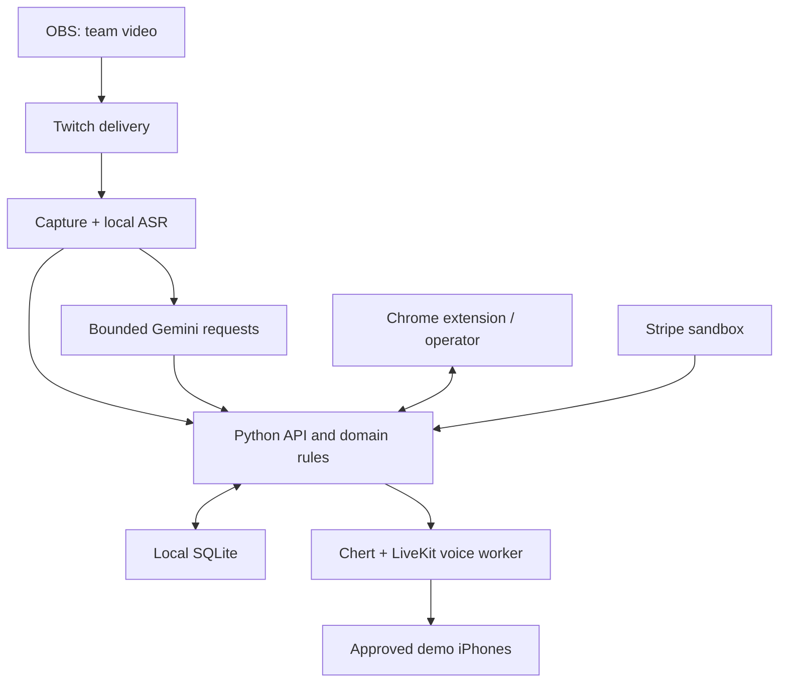

# Architecture and stack decisions

Planning specification, checked 2026-11-14. [PROJECT_PLAN](../PROJECT_PLAN.md) owns phases and gates. This describes the minimum useful topology, not an instruction to scaffold every component immediately.

## 1. Selected stack and tradeoffs

| Area | Selected direction | Reason / rejected initial alternatives |
|---|---|---|
| Chrome extension | TypeScript, React, WXT, Manifest V3 | WXT handles extension entrypoints/build tooling; React shares view components with dashboard. Raw Vite is viable but needs more extension assembly. No browser framework migration during the demo. |
| Operator UI | Small React/Vite app served by API or one known static origin | Same domain contracts and components; no SSR/Next.js need for a private control page. |
| API/domain | Python, FastAPI, Pydantic | Matches STT/Google/LiveKit ecosystem and owner's final choice. Rust adds an interface/deployment boundary without solving the main inference/network risks. |
| Persistence | SQLite, SQLAlchemy 2-style data access and migrations | One database on one machine, one API writer, small audience. Plain parameterized SQLite is also acceptable if team prefers it; pick once in P0, not both. |
| Capture | Streamlink + FFmpeg supervised by Python | Actual Twitch media; replaceable by explicit operator Chrome tab capture if needed. No unsupported promise of permanent access. |
| STT | Local faster-whisper on measured best laptop | No external per-minute charge; whisper.cpp is a measured alternative, especially for ARM. |
| Reasoning | Official Google Gen AI Python SDK, bounded structured requests | No runtime coding agent, graph framework, vector database or unbounded tool loop needed. |
| Client updates | WebSocket notification + HTTP state snapshot; polling fallback | Cloudflare Quick Tunnel currently excludes SSE. Financial commands remain HTTP with durable idempotency. |
| Test payments | Stripe-hosted sandbox Checkout | Card handling stays outside app; return navigation does not establish payment. |
| Calls | Chert managed sponsor line + verified LiveKit/voice runtime | Transport and AI are separate capabilities/costs. Manual FaceTime is approved fallback. |
| Testing | pytest, frontend unit runner, Playwright/manual extension smoke | Tests target invariants and actual browser/provider boundaries, not mirrored implementation details. |
| Packaging | Python lockfile + one JS lockfile; direct supervised processes initially | Docker Compose optional after actual ARM/x86 builds pass. Do not make containers the first unknown. |

Use supported installed versions and pin the tested combination. This kit intentionally avoids unverifiable exact package lockfiles. Do not install a package merely because an example names it; inspect official compatibility and current package identity.

## 2. Runtime topology

The API is the only business-state authority. Python media and call workers can be separate processes on laptops but submit typed commands to the API. They do not mount or edit its database. No shared SQLite file over NFS/SMB. The one-process API can maintain a connection registry in memory because durable state and event cursors live in the database. Adding a second web worker requires a new fanout design; do not set worker count to CPU count blindly.

Suggested placement after P0: Pi runs API/SQLite and static operator pages; strongest available laptop runs decode/STT; OBS runs on a suitable laptop with predictable performance; voice worker shares a spare machine if needed. If venue networking makes the Pi impractical, colocate API/database on an awake laptop. This is a host move, not permission to add a paid cloud service.

TigerData/PostgreSQL is optional if an actual sponsor account exists and solves measured database/network issues. It does not offload ASR or video decode. Migration incurs schema, transaction, connection, SSL and cost/expiry verification. Choose one database for the deadline; do not maintain two fully supported implementations as an abstraction exercise.

## 3. Proposed future repository boundaries

| Future path | Responsibility |
|---|---|
| `apps/extension/` | Manifest, popup, content shell, trusted background, optional operator capture document |
| `apps/operator/` | Authenticated health, approval, demo/run controls, evidence review |
| `packages/contracts/` | Generated/checked TypeScript types and example fixtures from accepted API schema |
| `services/api/` | Users/sessions, markets/wagers/ledger, raffle, payments receipt, commands/events |
| `services/worker/` | Capture, audio/frame sampling, STT, observation assembly, Gemini roles |
| `services/calls/` | Chert/LiveKit lifecycle and bounded voice tools; no direct ledger writes |
| `tests/fixtures/` | Short approved clips, expected labels, API examples, provider webhook fixtures |
| `docs/evidence/` | Sanitized gate records tied to commits and versions |
| `docs/runbooks/` | Verified startup, reset and recovery commands created during implementation |

These paths do not exist as implementations yet. Share contracts, not sprawling utility libraries. Avoid separate microservices for users, wallet, raffle, market and payments: they share atomic transactions and fit one application.

## 4. Frontend and embedding boundary

P1 first proves attachment to Twitch's SPA. Prefer resilient DOM anchors with one bounded observer, idempotent mount, route-change cleanup and unmount. Twitch can change DOM attributes; log an actionable mount failure and preserve player/chat usability. Scope styles with a ShadowRoot or a tested iframe. Keep controls out of fullscreen/player hit targets. Drag resize must have min/max sizes and not trap keyboard focus.

The PDF's hosted-URL panel is a feasibility branch. Only allow the team's fixed HTTPS origin, parse URLs properly, reject arbitrary hosts/schemes/credentials, and avoid using the backend as a URL fetch proxy. A remote iframe depends on Twitch frame policy, the hosted page's frame-ancestor policy, extension permissions and browser cookie behavior. Do not strip CSP/X-Frame-Options or promise that normal web embedding always works.

If accepted, the content shell owns placement and the separate frame owns business UI. A typed `postMessage` bridge verifies exact `event.origin`, exact `event.source`, protocol version, message type, frame nonce and current channel/run. Responses use an exact target origin. Discard unsolicited initialization, repeated exchanges and frames from previous navigation. Do not accept financial actions from page-global events. The backend still checks session and business rules.

Avoid third-party-cookie dependence. Keep a revocable opaque extension session in trusted extension storage; issue a short-lived one-use exchange code for a hosted frame, deliver it via the verified bridge, then keep a short-lived frame session in its memory. Do not transmit the long-lived extension credential to the Twitch page, query strings or wildcard message listeners. Validate this entire path in P0/P1 rather than designing tokens in parallel on two teams.

If the hosted path fails, the owner can select a bundled WXT/React ShadowRoot/extension-frame implementation with an allowlisted API base. This still implements the product interaction but changes the URL-embed requirement; record that choice. Do not claim a successful hosted embed if only the bundled panel works.

## 5. Identity and authorization

Invite-only test users are sufficient. An operator creates one-time enrollment codes; redeeming one creates an opaque session. Store token hashes and expiration server-side, not plaintext credentials in logs. Session revocation is supported. Profile name/Twitch name are labels, not authentication. Provider-verified phone binding is separate and only needed for actual call targets.

Separate roles: viewer, operator, media worker and call worker. Viewer can access own wallet/wagers and public market data. Operator can arm demo/raffle and select AI mode, but a frontend flag cannot grant the role. Media worker can submit bounded observations/candidates, not financial commands. Call worker has a call-specific scoped capability to prepare/confirm a wager for its bound user, never arbitrary user IDs.

CORS restricts browser origins but is not authentication. Check WebSocket Origin and authenticate before subscription. Native browser WebSocket cannot conveniently set a Bearer header; use a short-lived one-use WS ticket issued by authenticated HTTP, or a tested authenticated first-message protocol with a brief timeout. Do not place a durable token in a logged socket URL. Reject unauthenticated subscriptions and keep user-private events scoped to that user.

Restrict extension host permissions to twitch.tv and the selected backend origin. Restrict trusted storage access where supported; keep provider keys out of every frontend. The extension service worker is resumable glue, not the persistent market engine or sole timer. Popup closing must not stop the visible panel. Chrome sleep/service-worker shutdown require snapshot recovery.

## 6. Persistence and concurrency

Keep economic operations synchronous within short database transactions and run blocking database code outside the API event loop as needed. Do not hold a transaction while waiting on Stripe, Gemini, a websocket send or a phone call. The backend engineer selects and tests one SQLAlchemy/sqlite transaction pattern, including SQLite's explicit write-transaction acquisition; PostgreSQL row-lock pseudocode cannot be copied literally into SQLite.

SQLite allows one writer at a time. Use local disk, foreign keys on each connection, busy timeout, brief transactions, uniqueness constraints, and `BEGIN IMMEDIATE` or an equivalent verified serialization pattern for money mutations. Recheck deadline inside the transaction after acquiring write access. WAL can improve reader/writer overlap but does not permit multiple simultaneous writers. Verify the embedded SQLite version and current bug advisories before enabling WAL; keep a simpler journal mode if the installed version is unsuitable.

Use atomic conditional balance updates and ledger entries in the same transaction. A Python mutex is not the sole financial invariant. A unique operation key prevents duplicated effects; a payload hash detects idempotency-key misuse. Settlement and void are mutually exclusive conditional transitions. Outbox writes share the transaction; messages can be delivered more than once, so clients deduplicate.

A transaction journal holds append-only debit/credit movements and references payment/wager/settlement/redemption operations. Reconcile materialized balances against ledger totals. The funding source may have a negative accounting balance; user spendable balances and market escrow may not. Choose DB constraints accordingly rather than accidentally forbidding seed funding.

Back up with SQLite's supported backup mechanism or a safe stopped/checkpointed database procedure. Copying only the main file while WAL is active can omit recent commits. Keep database files outside source control. A reset creates a new stream session/run and explicitly new demo account funding; do not erase pending payment/call records or make old webhook IDs reusable.

## 7. Jobs, events and recovery

Persist jobs only for external effects or work that must survive restart: payment reconciliation, call dispatch, raffle call, terminal market action. Avoid a general distributed queue. Jobs have stable ID, run ID, kind, state, attempt, next-attempt time, lease/owner and external reference. A recovered job reconciles uncertain external state before submitting another request. A timeout does not prove the provider did nothing.

Media analysis can be a bounded lossy queue: keep current fresh observations, mark dropped evidence/gaps and pause affected markets. Economic events cannot be dropped. Distinguish these reliability requirements instead of funneling everything through Kafka.

WebSocket notifications carry event ID and aggregate version; snapshot contains a high-water mark. On reconnect, fetch a consistent snapshot, subscribe/replay after its watermark, and detect gaps. The initial implementation may always refetch after connection instead of a complex replay protocol, provided it cannot miss updates between subscription and snapshot. Version comparison prevents stale snapshots replacing newer state. Polling retrieves the same authoritative snapshot.

## 8. Network and deployment boundary

Use HTTPS/WSS when embedding hosted content inside Twitch. Plain HTTP to a private-LAN Pi may encounter mixed-content/private-network restrictions. Prove the exact browser/deployment path. A loopback test on one laptop does not prove four laptops or iPhones can reach it.

A Cloudflare Quick Tunnel can expose a development API without buying a domain, but has a random hostname, no uptime guarantee, no SSE and a 200 in-flight request limit. Hostname changes affect extension allowlists, frame policies, callback config and rehearsal links. An interactive tunnel email gate is incompatible with unattended worker/provider callbacks; use application authentication for these routes. A verified existing stable HTTPS domain is preferable if available without new spending. Keep admin routes authenticated even on an obscure URL.

Keep OBS WebSocket local/private with a password and allowlisted control commands. Do not expose its RPC port or an arbitrary command endpoint. OBS media control is not a stream audio API. Disable laptop sleep, confirm cooling/power/storage, and keep logs bounded. A crashed media worker should not crash the API/database.

## 9. Evidence and observability

An operator needs: current source/epoch, latest media/transcript age, queue depth, model role/version/latency, invalid-candidate reason, market state/deadline, ledger reconciliation, webhook receipts, call lifecycle, trial/quota balance and selected manual/automatic mode. Implement a useful diagnostic page before elaborate telemetry infrastructure.

Use structured logs with correlation IDs and redacted payloads. Keep evidence references and short reasons; avoid full API request/response dumps containing PII or secrets. AI prompts contain media and opaque IDs, not phone numbers, balances unless needed for a single bookie call, or cards. Use retention time/size caps for audio/images and retain the handful of disputed-market artifacts through review.

## Sources

Checked 2026-11-14: [FastAPI deployment workers](https://fastapi.tiangolo.com/deployment/server-workers/), [FastAPI background-task limits](https://fastapi.tiangolo.com/tutorial/background-tasks/), [SQLite WAL](https://www.sqlite.org/wal.html), [SQLite transactions](https://www.sqlite.org/lang_transaction.html), [SQLAlchemy SQLite](https://docs.sqlalchemy.org/en/20/dialects/sqlite.html), [WXT content scripts](https://wxt.dev/guide/essentials/content-scripts.html), [Chrome content script isolation](https://developer.chrome.com/docs/extensions/develop/concepts/content-scripts), [Chrome service-worker lifecycle](https://developer.chrome.com/docs/extensions/develop/concepts/service-workers/lifecycle), [Cloudflare Quick Tunnel constraints](https://developers.cloudflare.com/tunnel/get-started/quick-tunnels/).

